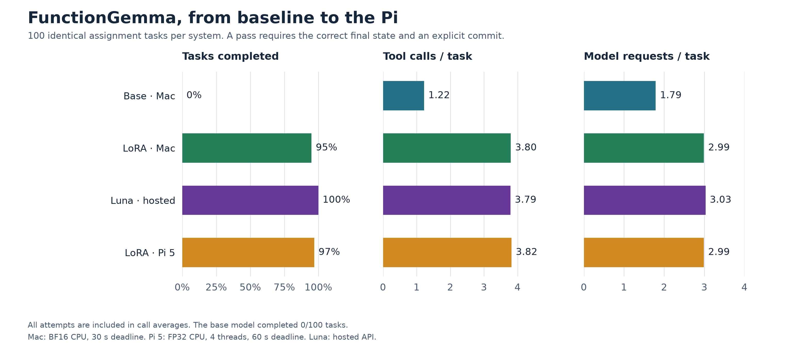
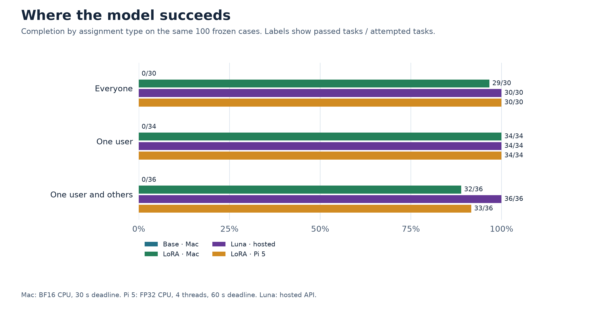
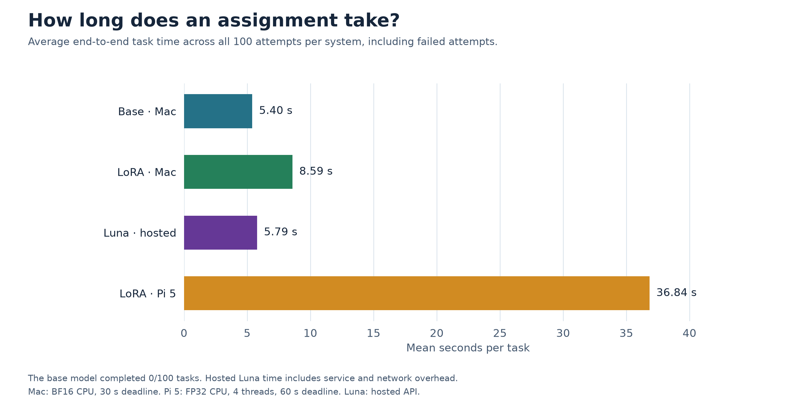
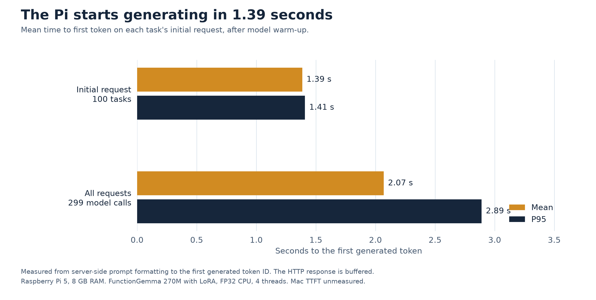
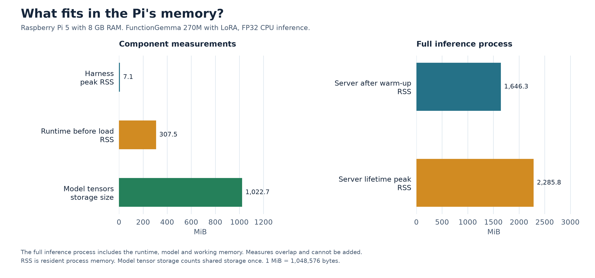

# FunctionGemma inference, from Mac to Raspberry Pi

17 November 2026 · 100 paired assignment tasks per system

FunctionGemma 270M with LoRA completed **95/100 tasks on the Mac** and
**97/100 on an 8 GB Raspberry Pi 5**. The base model completed 0/100, and the
hosted Luna benchmark completed 100/100.

[HTML report](report.html) · [Report metrics](report-data.json)

## The task and training

The model inspects a three-person roster, updates the requested job assignments
and explicitly commits the result. A pass requires the exact intended final
state and a successful commit.

LoRA refers to a rank-16 adapter with approximately 3.8 million trainable
parameters, trained using approximately 5,000 successful task demonstrations
generated by GPT Luna. The adapter was merged into FunctionGemma for inference.
The harness generated the tasks, exposed the tools and evaluated the final
SQLite state.

## Baseline, LoRA and Luna



| System | Passed | Tools / task | Requests / task | Mean task | Median | P95 |
| --- | ---: | ---: | ---: | ---: | ---: | ---: |
| Base · Mac | 0/100 | 1.22 | 1.79 | 5.40 s | 3.76 s | 11.09 s |
| LoRA · Mac | 95/100 | 3.80 | 2.99 | 8.59 s | 8.39 s | 10.67 s |
| Luna · hosted | 100/100 | 3.79 | 3.03 | 5.79 s | 5.79 s | 7.81 s |
| LoRA · Pi 5 | 97/100 | 3.82 | 2.99 | 36.84 s | 38.86 s | 51.94 s |

Call counts and task times include every attempt. The base model often ended
early, so its shorter times and lower call counts include incomplete attempts.



The Pi completed 30/30 everyone tasks, 34/34 one-user tasks and 33/36 mixed
assignments. Its three failures committed an incorrect final state.

## Task completion time



The Pi averaged 36.84 seconds per task, compared with 8.59 seconds on the Mac
for the same merged checkpoint. Among the Pi's 97 successful attempts, the
average was 36.64 seconds. Task time covers harness launch through exit,
including SQLite and HTTP requests to the inference server.

## First-token latency on the Pi



After a separate warm-up task, the initial model request averaged **1.39 seconds**
to the first generated token, with a p95 of 1.41 seconds. Across all 299 model
requests, the average was **2.07 seconds**, with a p95 of 2.89 seconds.

Timing starts before server-side prompt formatting and ends when the first
generated token ID is emitted. The HTTP response is buffered until generation
finishes. Initial requests are a subset of all requests. Mac first-token
timings were unavailable in the archived measurements.

## Memory on the Pi



| Component or process | Memory | Measurement |
| --- | ---: | --- |
| Rust harness | 7.1 MiB | Maximum per-task peak RSS |
| Inference runtime before model load | 307.5 MiB | RSS after Python, PyTorch and Transformers imports |
| Model tensors | 1,022.7 MiB | FP32 parameter and buffer storage |
| Inference server after warm-up | 1,646.3 MiB | RSS including the loaded model and retained working memory |
| Inference server peak | 2,285.8 MiB | Lifetime peak RSS, including startup and all tasks |

The full inference process includes the runtime, model and working memory.
These measurements overlap and cannot be added. Model tensor storage counts
shared storage once. RSS measures resident process memory.
One MiB is 1,048,576 bytes.

The on-disk checkpoint was 1,022.7 MiB. At the end of the run, the server used
zero swap and the firmware reported zero throttling flags. The highest
temperature sampled after a task was 56.8 °C.

## Measurement conditions

All four systems used the same 100 frozen cases, seeds 1001–1100, with the same
starting rosters, tool schemas and scoring. Each system ran one attempt per
case. FunctionGemma used greedy decoding and a 256-token output cap.

The Mac FunctionGemma runs used BF16 CPU inference. The Pi used FP32 CPU inference
with four threads, running the harness, SQLite and inference server on the same
Raspberry Pi 5 Model B with 8 GB RAM. Both used PyTorch 2.9.1 and Transformers
4.57.6. The Pi used the identical merged step-1884 checkpoint from the Mac's
LoRA evaluation.

The Pi used a 60-second request deadline. An initial 12-case timing run with the
original 30-second deadline recorded four timeouts whose generations completed
in 37.5–39.1 seconds. All four assignments passed with the longer deadline.
The final Pi run had zero request timeouts. The Mac runs used a 30-second deadline.
Hardware and precision differed, limiting conclusions about the two-point
completion-rate difference.

Luna used a hosted API, a 4,096-token output cap and up to four concurrent tasks.
Its times include network and service overhead. FunctionGemma ran one task at a
time. Hosted model memory was unavailable.

The 100 cases were excluded from training and validation examples. Earlier
benchmark failures informed the expanded dataset, so these results describe a
repeat benchmark. The separately reserved 600 final test cases were unevaluated.
The training run combined more data, different task proportions and additional
training steps.

P95 uses the nearest-rank definition. GNU time measured harness peak RSS.
Linux process files measured server RSS and its lifetime high-water mark.

## Charts and report source

The five chart images above are available individually in [charts/](charts/).
The [metrics file](report-data.json) contains aggregated results and hashes for
the evaluated checkpoint and frozen cases.

Regenerate the HTML report and charts with Python 3.10 or later and Matplotlib.

```sh
python3 -m pip install matplotlib
python3 scripts/render_report.py
```
